# CodeMind — Technical Limitations & Future Scope

In accordance with rigorous academic and engineering standards, this document explicitly discloses the current operational boundaries, architectural constraints, and future engineering roadmap of CodeMind.

---

## 1. Technical Limitations & Boundaries

### 1.1 Concurrency & Deployment Architecture
- **Single-Worker Process Constraint (`--workers 1`):**
  CodeMind maintains the parsed Python ASTs, NetworkX Software Knowledge Graph, in-memory BM25 indices, and vector stores directly inside the Python process memory (`CodebaseState`). Synchronization is achieved through a process-local `threading.RLock()`.
- **Multi-Worker Process Incompatibility:**
  Spawning multiple Uvicorn worker processes (e.g. `uvicorn --workers 4`) creates four isolated Python memory heaps. An ingestion scan performed in Worker 1 will not update the in-memory state of Workers 2, 3, or 4. CodeMind must be deployed with `--workers 1` until centralized external caching is introduced.

---

### 1.2 Information Retrieval Mathematical Bounds
- **Theoretical Precision@3 Upper Bound ($0.5400$):**
  In the verified 50-query golden dataset ([golden_dataset.json](file:///c:/Users/user/Desktop/Codemind/CodeMind/tests/benchmarks/golden_dataset.json)):
  - 25 queries have exactly 1 relevant ground-truth file ($|GT| = 1$).
  - 19 queries have 2 relevant ground-truth files ($|GT| = 2$).
  - 4 queries have 3 relevant ground-truth files ($|GT| = 3$).
  - 2 queries have 4 relevant ground-truth files ($|GT| = 4$).

  Under standard Information Retrieval evaluation where Precision@3 divides hits by 3 (rather than $\min(3, |GT|)$), single-target queries can achieve at most $1/3 \approx 0.3333$ precision under a strict unique-file constraint. The exact dataset-wide theoretical ceiling is:
  $$\text{Ceiling}_{\text{unique-file}} = \frac{25 \times \frac{1}{3} + 19 \times \frac{2}{3} + 4 \times 1.0 + 2 \times 1.0}{50} = \frac{27}{50} = \mathbf{0.5400}$$

- **Measured Metrics vs. Proposed Acceptance Targets:**
  | Metric | Baseline | Optimized | Proposed Target | Audit Status |
  | :--- | :--- | :--- | :--- | :--- |
  | **Mean Precision@3** | 0.1867 | **0.5133** | $\ge 0.7000$ | **NOT MET (Bounded)** |
  | **Mean Recall@3** | 0.3350 | **0.7117** | $\ge 0.8000$ | **NOT MET** |
  | **Mean Reciprocal Rank (MRR)** | 0.2633 | **0.8333** | $\ge 0.7500$ | **MET / PASSED** |

  In strict adherence to evaluation integrity, Precision@3 and Recall@3 are formally reported as **NOT MET**. Achieving $0.5133$ (+175% over baseline) represents a substantial practical improvement near the mathematical ceiling.

---

### 1.3 Language & AST Scope
- **Python Language Focus:**
  Concrete AST symbol extraction (classes, methods, functions, calls, and imports) is implemented for Python using the standard library `ast` module.
- **Polyglot Repositories:**
  Non-Python files (e.g. JavaScript, TypeScript, HTML, CSS, C++, Go) are ingested, filtered, line-counted, and indexed for lexical/text search, but do not undergo syntactic AST parsing or call-graph construction.

---

### 1.4 Dynamic Python Semantics
- **Static vs. Runtime Boundary:**
  CodeMind is a static analysis platform. It cannot trace runtime dynamic metaprogramming:
  - Dynamic imports (e.g. `importlib.import_module(var)`).
  - Dynamic attribute access and execution (e.g. `getattr(obj, method_name)()`, `eval()`, `exec()`).
  - Runtime monkey-patching or dynamic dependency injection containers.

---

### 1.5 Git History Depth & Shallow Clones
- **Shallow Clone Limitation:**
  Repositories cloned with `--depth 1` (shallow clones) lack historical commit logs. In these repositories:
  - Code churn metrics and temporal logical coupling cannot be computed.
  - **Graceful Degradation:** The `MaintenanceHotspotDetector` detects the absence of Git history, flags the evidence coverage as `is_partial = True`, and dynamically renormalizes risk weights across available AST and graph signals.

---

### 1.6 Memory Scalability on Large Codebases
- **In-Memory Graph Footprint:**
  The NetworkX multi-relational graph operates in RAM:
  - `repo_small` (15 files, ~500 LOC): 0.91 MB peak memory.
  - `repo_medium` (58 files, ~5,000 LOC): 3.25 MB peak memory.
  - `repo_large` (265 files, ~30,000 LOC): 33.49 MB peak memory.
  For repositories exceeding 500,000 LOC or 100,000 graph nodes, RAM consumption can exceed 1 GB. Very large monorepos require disk-backed graph databases.

---

### 1.7 Containerization & Live Docker Verification
- **Static Verification State:**
  The provided `Dockerfile` and `.dockerignore` adhere to production best practices (multi-stage build, non-root user, single-worker constraint, healthcheck).
- **Execution Boundary:**
  The local development machine (Windows host) does not have a running Docker daemon / Docker CLI installed. Container execution has been verified via static linting and configuration validation rather than live Docker runtime testing.

---

## 2. Future Scope & Engineering Roadmap

```mermaid
flowchart LR
    subgraph NearTerm ["Phase 11 (Near-Term)"]
        TreeSitter["Multi-Language AST (Tree-sitter)"]
        Lockfile["Hash-Pinned Lockfile Generation"]
        OpenAPISpec["Automated OpenAPI Spec Export"]
    end

    subgraph MidTerm ["Phase 12 (Mid-Term)"]
        GraphDB["Persistent Graph DB (Neo4j / Memgraph)"]
        RedisState["External Centralized State (Redis Cache)"]
        MultiWorker["Horizontally Scalable Workers (Celery)"]
    end

    subgraph LongTerm ["Phase 13 (Long-Term)"]
        LSP["Language Server Protocol (VS Code Extension)"]
        PRBot["GitHub PR Architectural Conformance Bot"]
        InteractiveRefactor["Agentic Refactoring & Auto-Fix Engine"]
    end

    NearTerm --> MidTerm --> LongTerm
```

### 2.1 Multi-Language Static Analysis via Tree-Sitter
Integrate `tree-sitter` bindings to expand concrete AST symbol and call-graph extraction to JavaScript, TypeScript, Go, Java, and C++.

### 2.2 Centralized State & Persistent Graph Database
Migrate from in-memory NetworkX graphs to a persistent graph database (e.g. **Neo4j** or **Memgraph**) using Cypher queries. This enables horizontal scaling across multiple Uvicorn worker processes backed by a **Redis** session cache.

### 2.3 IDE & CI/CD Integrations
- **VS Code Extension (LSP):** Provide in-editor architectural conformance warnings (e.g. flagging upward layer leaks directly in the IDE).
- **GitHub Action PR Gate:** Automatically block pull requests that degrade the Architecture Conformance Index (ACI) or introduce new circular package dependencies.

### 2.4 Agentic Code Refactoring
Extend the Agentic Investigation Engine to propose and preview automated refactoring diffs that dismantle God classes, untangle package cycles, and eliminate layer violations.
