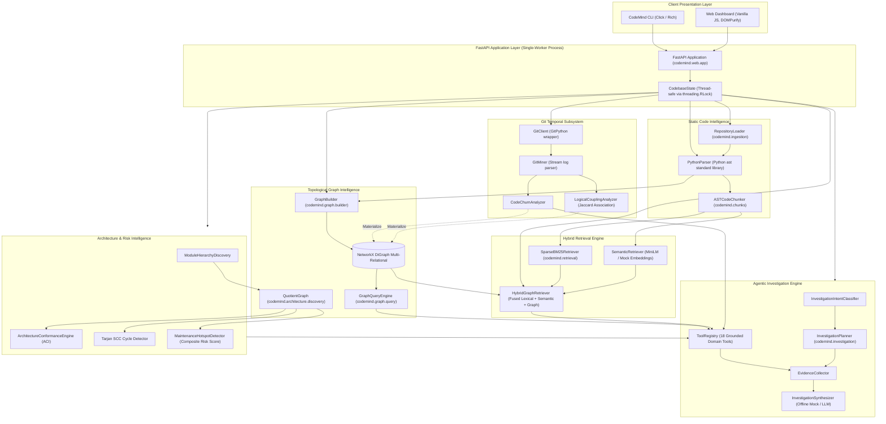
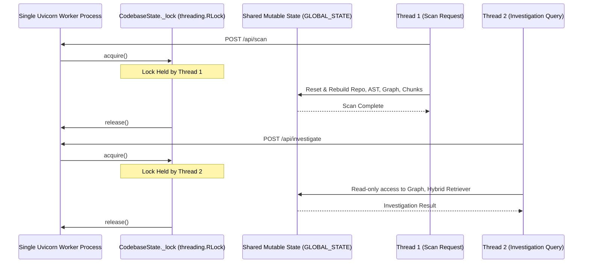

# CodeMind — System Architecture

This document provides a comprehensive technical breakdown of CodeMind's architecture, internal subsystems, multi-relational knowledge graph schema, and concurrency model.

---

## 1. High-Level Architecture Diagram



---

## 2. Subsystem Deep-Dive

### 2.1 Repository Ingestion & Static AST Parsing
- **`codemind.ingestion.repo_loader.RepositoryLoader`**: Recursively scans target paths, processes `.zip` archives into temporary locations, and clones remote Git repositories. It enforces a multi-tier `FileFilter` that ignores noisy directories (`.git`, `node_modules`, `venv`, `__pycache__`, `dist`, `.tox`) and detects binary files via null-byte inspection.
- **`codemind.parsing.python_parser.PythonParser`**: Utilizes Python's native `ast` module to traverse the Abstract Syntax Tree. It extracts:
  - Class definitions, bases, docstrings, and class-level attributes.
  - Function and method definitions, arguments, return annotations, and cyclomatic complexity branches (`if`, `for`, `while`, `try`, `bool_op`).
  - Import statements (`import x`, `from x import y`).
  - Concrete call-sites (`obj.method()`, `func()`).
  - **Syntax Error Resilience**: Captures syntax errors gracefully without terminating ingestion, recording line numbers and error diagnostics.

### 2.2 Semantic & AST-Aware Chunking
- **`codemind.chunks.chunker.ASTCodeChunker`**: Unlike naive fixed-size chunking, CodeMind constructs semantic chunks aligned with AST boundaries:
  - `CLASS` chunks: Preserves class signature, docstring, and top-level member declarations.
  - `FUNCTION` and `METHOD` chunks: Preserves decorator stack, parameter list, full body, and return context.
  - `MODULE_DOC` chunks: Preserves module-level documentation.
  - Every chunk retains its exact `file_path`, `start_line`, and `end_line` for deterministic citation verification.

### 2.3 Software Knowledge Graph Schema
The Software Knowledge Graph is implemented using a **NetworkX `DiGraph`** containing multi-relational entities and edges:

#### Node Types
| Node Type | Key Attributes | Description |
| :--- | :--- | :--- |
| `FILE` | `path`, `language`, `lines`, `size` | Source file entity on disk. |
| `CLASS` | `name`, `docstring`, `bases`, `file_path`, `start_line`, `end_line` | Concrete object-oriented class. |
| `FUNCTION` | `name`, `docstring`, `args`, `file_path`, `start_line`, `end_line` | Standalone function definition. |
| `METHOD` | `name`, `class_name`, `docstring`, `args`, `start_line`, `end_line` | Method belonging to a class. |
| `MODULE` | `package`, `relative_path`, `layer` | Logical architectural module. |
| `PACKAGE` | `name`, `path` | Package directory namespace. |
| `COMMIT` | `hash`, `author`, `date`, `subject` | Materialized Git commit node. |

#### Edge Types
| Edge Type | Source $\to$ Target | Description |
| :--- | :--- | :--- |
| `CONTAINS` | `FILE` $\to$ `CLASS` / `FUNCTION` | Hierarchical syntactic containment. |
| `CALLS` | `FUNCTION` / `METHOD` $\to$ `FUNCTION` / `METHOD` | Directional call site interaction. |
| `IMPORTS` | `FILE` $\to$ `MODULE` / `FILE` | Module dependency import link. |
| `INHERITS` | `CLASS` $\to$ `CLASS` | Object-oriented class inheritance. |
| `COMMITTED_IN` | `FILE` $\to$ `COMMIT` | Historical modification linkage. |
| `CO_CHANGED_WITH` | `FILE` $\to$ `FILE` | Logical temporal coupling link ($Jaccard \ge 0.5$). |

---

### 2.4 Hybrid Lexical-Semantic Retrieval Engine
CodeMind uses a two-stage hybrid fusion model:
1. **Lexical Retrieval (`SparseBM25Retriever`)**:
   - BM25 score calculation with term-frequency saturation ($k_1=1.5$) and document-length normalization ($b=0.75$).
   - Normalized into $[0, 1]$ via $S_{\text{BM25}} = \text{score} / \max(S_{\text{raw}})$.
2. **Dense Vector Retrieval (`SemanticRetriever`)**:
   - 384-dimensional dense vectors generated via `all-MiniLM-L6-v2` (or 64-dimensional deterministic mock embeddings).
   - Cosine similarity scores bounded in $[0, 1]$.
3. **Hybrid Score Fusion**:
   $$S_{\text{fused}} = 0.70 \cdot S_{\text{BM25}} + 0.30 \cdot S_{\text{Dense}}$$
4. **Graph Neighborhood Expansion**:
   - Seed candidates are expanded across `CALLS`, `INHERITS`, and `CONTAINS` edges.
   - Reverse-caller queries (e.g. *"who calls X"*) receive an explicit $+1.50$ boost along incoming `CALLS` edges.
5. **Diversity & Chunk Deduplication**:
   - Duplicate chunks from the same file receive a soft penalty factor ($0.85$).
   - Hard cap enforces $\le 2$ chunks per file, guaranteeing diversity in top-$k$ evidence slots.

---

### 2.5 Agentic Investigation Engine
CodeMind's investigation subsystem follows a deterministic 5-stage pipeline:

```
[User Query]
     |
     v
[1. Intent Classification] --> (UNDERSTAND, STRUCTURE, IMPACT, EVOLUTION, INSIGHTS)
     |
     v
[2. Dynamic Planning]    --> Construct execution plan with optimal tools & parameters
     |
     v
[3. Tool Execution]      --> Fetch evidence from ToolRegistry (18 domain tools)
     |
     v
[4. Topological Expand]  --> Expand evidence along Knowledge Graph & Temporal links
     |
     v
[5. Grounded Synthesis]  --> Generate structured markdown response with verifiable citations
```

#### Tool Registry Categorization:
- **Architecture Tools**: `get_architecture_overview`, `analyze_layer_conformance`, `detect_package_cycles`, `explain_maintenance_hotspots`, `get_analysis_coverage`.
- **Code & AST Tools**: `get_symbol_definition`, `list_module_symbols`, `inspect_class_hierarchy`.
- **Graph & Impact Tools**: `query_incoming_calls`, `query_outgoing_calls`, `calculate_change_impact`, `select_affected_tests`.
- **Temporal Tools**: `get_file_history`, `get_churn_hotspots`, `query_logical_couplings`.
- **Retrieval Tools**: `hybrid_code_search`, `bm25_lexical_search`.

---

### 2.6 Architecture Conformance & Hotspot Intelligence
- **Module Hierarchy Discovery**: Automatically clusters repository files into architectural modules and assigns them to canonical architectural layers:
  1. `PRESENTATION` / `API`
  2. `APPLICATION` / `SERVICES`
  3. `DOMAIN` / `MODELS`
  4. `INFRASTRUCTURE` / `STORAGE` / `ADAPTERS`
- **Architecture Conformance Index (ACI)**:
  $$\text{ACI} = \max\left(0.0, 1.0 - \frac{\text{Violations}}{\max(1, \text{Total Module Imports})}\right)$$
  - Flags **Layer Leaks** (lower layers importing higher layers).
  - Flags **Forbidden Imports** (e.g. Domain layer importing Infrastructure adapters).
  - Flags **Layer Skipping** (e.g. Presentation layer bypassing Application to access DB directly).
- **Package Cycle Detection**: Executes **Tarjan's Strongly Connected Components (SCC)** algorithm on the quotient graph to isolate circular package dependencies.
- **Maintenance Hotspots & Risk Score**:
  Composite module risk is computed using approved Phase 9 weights:
  $$\text{Risk}_{\text{base}} = 0.30 \cdot C_{\text{cyclomatic}} + 0.25 \cdot C_{\text{centrality}} + 0.30 \cdot C_{\text{churn}} + 0.15 \cdot C_{\text{coupling}}$$
  When signals are missing (e.g., no Git history), weights are dynamically renormalized:
  $$w_i' = \frac{w_i}{\sum_{j \in \text{available}} w_j}$$
  An interaction multiplier applies when churn, complexity, and centrality simultaneously exceed thresholds ($\ge 0.60$), clamped to $[1.0, 1.75]$.

---

## 3. Concurrency & State Management Model



### Concurrency Rules & Constraints
1. **Single-Worker Process Model**: CodeMind stores the parsed AST, NetworkX Knowledge Graph, and in-memory BM25/vector indices in memory inside `CodebaseState`. Uvicorn must be executed with `--workers 1`.
2. **Process-Local Mutual Exclusion**: All mutable operations (`scan_and_analyze`) and read operations acquire a process-local `threading.RLock()`.
3. **No Inter-Process State Bleed**: Running multiple Uvicorn worker processes (`--workers 4`) creates separate process address spaces where background updates in Worker A are invisible to Worker B. Multi-worker scaling requires external caching (Redis/PostgreSQL), documented as future scope.
