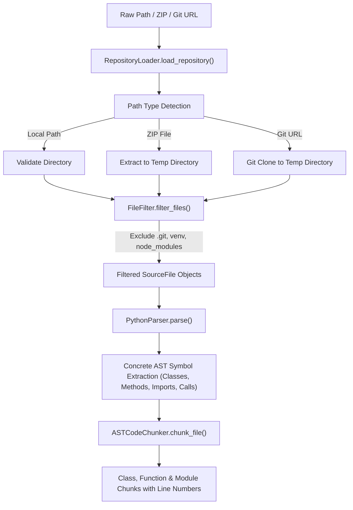
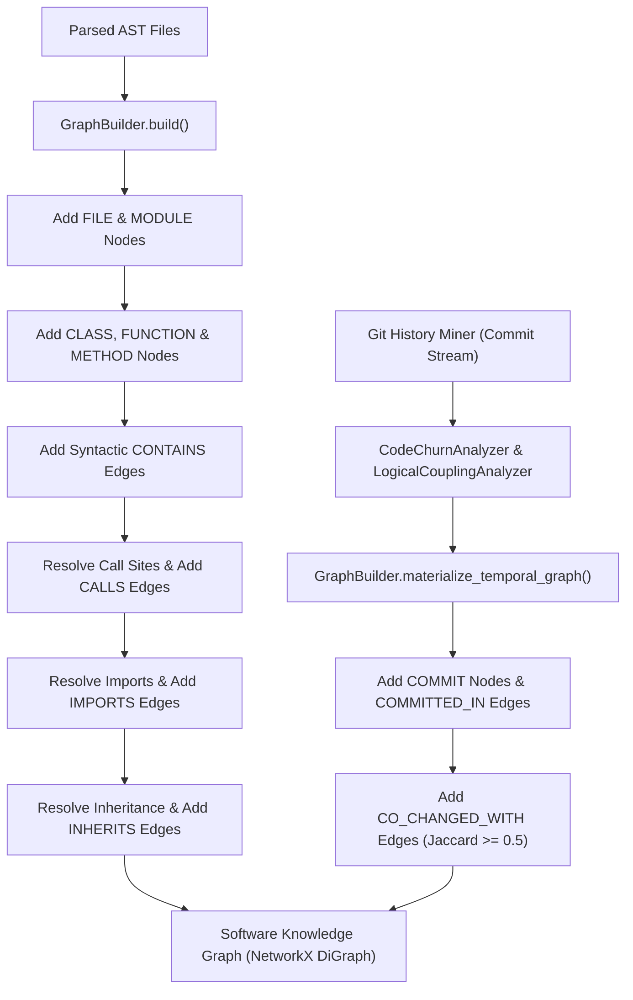
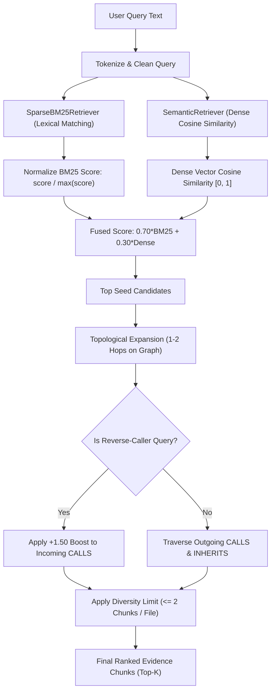
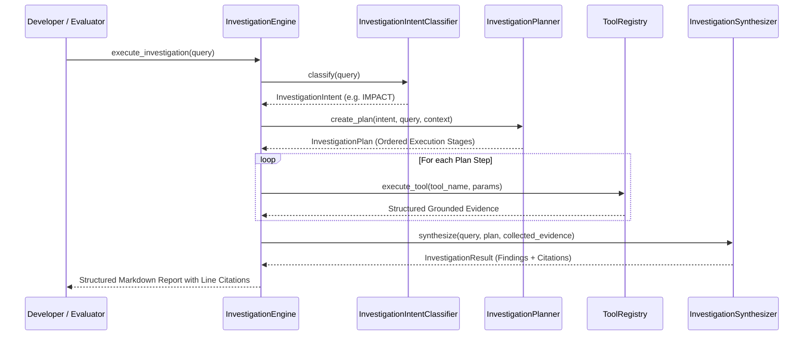
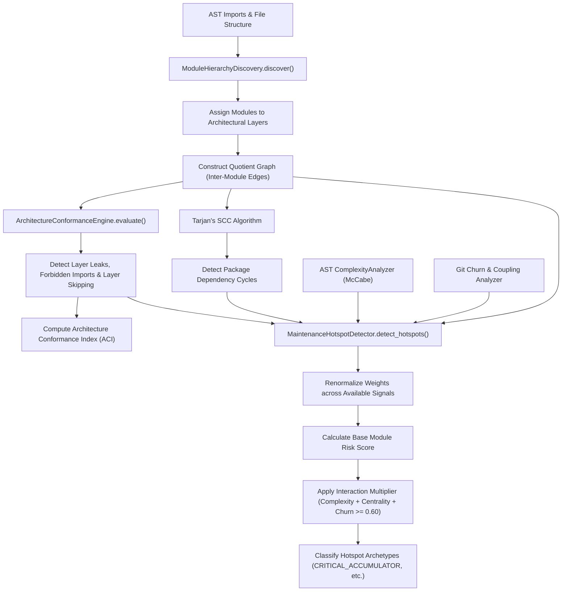

# CodeMind — Technical Workflow

This document describes the concrete, step-by-step technical workflows executed by CodeMind across its ingestion, graph construction, retrieval, agentic investigation, and architectural analysis subsystems.

---

## Workflow 1: Repository Ingestion & AST Parsing

### Detailed Execution Steps:
1. **Source Resolution:** The user supplies a local directory path (`.`), a `.zip` archive, or a remote Git repository URL.
2. **File Filtering:** The `FileFilter` evaluates every file against exclusion patterns (`.git`, `node_modules`, `venv`, `dist`, `__pycache__`, `.tox`). Non-Python binary files are detected via null-byte inspection and excluded from AST parsing.
3. **AST Construction:** For every valid Python file, standard library `ast.parse()` generates the syntax tree.
4. **Symbol Discovery:** `PythonParser` traverses the AST with an AST Visitor, identifying:
   - Concrete `ClassDefinition` nodes with inheritance bases.
   - `FunctionDefinition` / `AsyncFunctionDefinition` nodes with arguments and return types.
   - `Call` nodes capturing function and method invocations.
   - `Import` and `ImportFrom` statements.
5. **Syntax Error Handling:** If a syntax error is encountered, `is_valid` is set to `False`, the error diagnostic is recorded, and the pipeline continues without terminating.
6. **AST-Aware Chunking:** `ASTCodeChunker` segments files into semantic units (`CLASS`, `FUNCTION`, `METHOD`, `MODULE_DOC`), preserving start and end line boundaries.

---

## Workflow 2: Knowledge Graph Construction & Temporal Graph Materialization

### Detailed Execution Steps:
1. **Node Population:** `GraphBuilder` instantiates unique nodes for every File, Class, Function, and Method, indexed by canonical IDs (e.g. `file::codemind/web/app.py`, `func::codemind/web/app.py::create_app`).
2. **Syntactic Containment:** `CONTAINS` edges are wired hierarchically from File to Class, and Class to Method.
3. **Call Resolution:** Call sites extracted during AST analysis are resolved against known function and method signatures in the symbol table, creating directed `CALLS` edges.
4. **Import & Inheritance Wiring:** `IMPORTS` edges link dependent modules, and `INHERITS` edges link derived classes to their base classes.
5. **Temporal Graph Materialization (Phase 7):**
   - `GitMiner` extracts commit metadata, author details, dates, and diff stats.
   - `CodeChurnAnalyzer` aggregates net line additions and deletions per file.
   - `LogicalCouplingAnalyzer` calculates the Jaccard similarity coefficient for all co-changed file pairs across commits:
     $$J(A, B) = \frac{|\text{Commits containing both } A \text{ and } B|}{|\text{Commits containing } A \text{ or } B|}$$
   - File pairs meeting support ($\ge 3$ co-commits) and confidence ($\ge 0.5$) thresholds are injected into the Knowledge Graph as bidirectional `CO_CHANGED_WITH` edges.

---

## Workflow 3: Hybrid Lexical-Semantic Retrieval

### Detailed Execution Steps:
1. **Dual Query Execution:** The query is concurrently processed by the lexical BM25 index and the dense embedding vector space.
2. **Score Normalization:** Raw BM25 scores are dynamically normalized into $[0, 1]$ relative to the highest-scoring candidate in the active query. Dense embeddings are bounded in $[0, 1]$ via cosine similarity.
3. **Weighted Fusion:** The fused score combines both signals ($0.70 \cdot \text{BM25} + 0.30 \cdot \text{Dense}$).
4. **Graph-Aware Expansion:** The top seed chunks are mapped to their corresponding graph nodes. The graph is traversed up to 2 hops along `CALLS`, `INHERITS`, and `CONTAINS` edges to retrieve contextual dependencies.
5. **Reverse-Caller Boosting:** If the query indicates a reverse call investigation (e.g. *"who calls", "where is X used"*), incoming `CALLS` edges receive an explicit $+1.50$ score boost.
6. **Diversity Filtering:** A soft penalty ($0.85$) is applied to duplicate chunks from the same file, and a hard constraint limits representation to at most 2 chunks per file, preventing single-file retrieval saturation.

---

## Workflow 4: 5-Stage Agentic Investigation Pipeline

### Detailed Execution Steps:
1. **Stage 1 — Intent Classification:** `InvestigationIntentClassifier` analyzes the query using keyword heuristics and syntactic structure, categorizing it into one of five canonical intents:
   - `UNDERSTAND`: Semantic comprehension of functions, modules, or features.
   - `STRUCTURE`: Architectural relationships, class hierarchies, and imports.
   - `IMPACT`: Upstream and downstream blast radius of changes.
   - `EVOLUTION`: Git commit history, code churn, and author ownership.
   - `INSIGHTS`: Hotspots, technical debt, and architectural violations.
2. **Stage 2 — Dynamic Planning:** `InvestigationPlanner` constructs an execution graph consisting of sequential and parallel tool calls tailored to the identified intent.
3. **Stage 3 — Tool Execution & Evidence Collection:** Tools are dispatched through the `ToolRegistry`. Tools query the AST, Knowledge Graph, Git subsystem, or Architecture engine, returning structured `InvestigationEvidence` records.
4. **Stage 4 — Topological Expansion:** The evidence collector expands collected symbols along graph relationships to ensure complete context.
5. **Stage 5 — Grounded Synthesis:** `InvestigationSynthesizer` compiles the collected evidence into a cohesive markdown response. When offline, deterministic template synthesis formats findings, verified citations, and explicit limitations without external LLM dependencies.

---

## Workflow 5: Architecture Conformance & Hotspot Risk Analytics

### Detailed Execution Steps:
1. **Module Hierarchy Discovery:** Repository files are partitioned into high-level packages and mapped to standard architectural layers (`PRESENTATION`, `APPLICATION`, `DOMAIN`, `INFRASTRUCTURE`).
2. **Quotient Graph Construction:** Generates an inter-module directed graph where nodes represent architectural modules and edges represent aggregated import statements.
3. **Conformance Evaluation:** Evaluates each import against layer boundaries:
   - **Layer Leak:** An import directed from a lower layer to a higher layer (e.g. `storage` importing `services`).
   - **Forbidden Import:** An import violating strict boundary rules (e.g. `domain` importing third-party `adapters`).
   - **Layer Skipping:** Presentation layer importing storage directly, bypassing application services.
   - **ACI Calculation:** $\text{ACI} = \max(0.0, 1.0 - \text{Violations} / \text{Imports})$.
4. **Package Cycle Detection:** Executes Tarjan's Strongly Connected Components algorithm on the quotient graph. Any strongly connected component with size $> 1$ or containing a self-loop is isolated as a circular package dependency.
5. **Hotspot Detection & Risk Calculation:**
   - Evaluates cyclomatic complexity (McCabe branches), network degree centrality, historical line churn, and logical coupling.
   - Dynamically renormalizes base weights across available signals:
     $$w_i' = \frac{w_i}{\sum_{j \in \text{available}} w_j}$$
   - Applies interaction multiplier clamped to $[1.0, 1.75]$.
   - Classifies module into a `HotspotArchetype` with explicit evidence coverage reporting.
